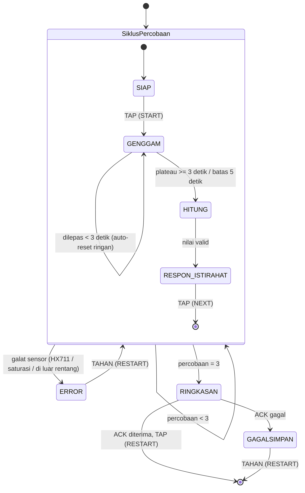

# Alur Proyek Hand Grip Dynamometer
**Proyek akhir - embedded system**

> ## ⚠ STATUS: WORK IN PROGRESS (WIP)
> Dokumen ini masih dikerjakan dan akan terus berubah. Firmware, PCB final, housing final, dan kalibrasi **belum selesai**; yang sudah ada hanyalah keputusan desain, beberapa pengukuran, dan uji awal. Versi: **WIP-0.1** (10 Okt. 2026).
> Sitasi **belum dikumpulkan**; bagian yang bersandar pada literatur diberi tanda `[sitasi]` dan akan dilengkapi di Bagian 23.

Dokumen ini menjelaskan alur proyek dari ujung ke ujung: data dan state yang dipakai firmware, konstanta, perlindungan input, fungsi, alur utama, perangkat keras, kalibrasi, logging, antarmuka, housing, pengujian, risiko, dan jadwal. Fungsinya sama dengan "Alur Program" pada proyek C: menjawab *apa yang terjadi, urutannya, dan kenapa dipilih begitu*. Semua bagian ditulis sebagai **rencana**: apa yang akan dibangun dan bagaimana. Bagian yang sudah terbukti diukur atau diuji diberi tanda ✔.

## 0. CARA MEMBACA DOKUMEN INI

| Tanda | Arti |
|-------|------|
| ✔ | **Terverifikasi**: sudah diukur atau diuji sendiri (tanggal dicantumkan) |
| ▣ | **Rencana**: keputusan sudah diambil dan akan dikerjakan |
| ◐ | **Sedang dikerjakan** (WIP) |
| `[sitasi]` | Klaim yang bersandar pada literatur; sumbernya akan disusun di Bagian 23 |
| *nilai awal* | Angka rencana yang dipakai sebagai titik mulai dan **disetel lewat eksperimen** yang dinamai di sebelahnya (E1, E2, ...). Hasil eksperimen menggantikannya |

**Peta isi**

| No | Bagian | | No | Bagian |
|----|--------|-|----|--------|
| 1 | Ringkasan dan tujuan | | 13 | Housing |
| 2 | Arsitektur dan struktur berkas | | 14 | Pengujian dan verifikasi |
| 3 | Struktur data | | 15 | Risiko dan mitigasi |
| 4 | Konstanta dan threshold | | 16 | Jadwal dan pembagian kerja |
| 5 | Perangkat keras | | 17 | Anggaran dan pengadaan |
| 6 | Fungsi pelindung | | 18 | Build dan cara menjalankan |
| 7 | Fungsi firmware | | 19 | Keselamatan dan memori |
| 8 | Alur utama (state machine) | | 20 | Constraint dan edge case |
| 9 | Pembacaan HX711 dan sinyal | | 21 | Riwayat keputusan |
| 10 | Kalibrasi | | 22 | Status WIP |
| 11 | Logging dan `logger.py` | | 23 | Sitasi (akan disusun) |
| 12 | Antarmuka pengguna | | | |

---

## 1. RINGKASAN DAN TUJUAN

### 1.1 Apa yang dibangun
Hand grip dynamometer digital: dua pelat aluminium dikepit tangan, sebuah load cell di antara pelat membaca gaya, modul HX711 mendigitalkannya, dan ESP32 menampilkan hasil di LCD 16x2, menyalakan LED selama genggaman, dan mengirim hasil tiap sesi ke laptop untuk disimpan sebagai berkas CSV secara otomatis.

### 1.2 Kenapa
Kekuatan genggam (HGS) makin dipakai sebagai indikator kesehatan, dan nilai klinisnya terutama datang dari pengukuran berulang dari waktu ke waktu, bukan satu kali baca `[sitasi]`. Dynamometer klasik umumnya menampilkan angka tanpa pencatatan otomatis sehingga nilainya disalin manual, rawan salah dan hilang `[sitasi]`. Kontribusi proyek ini: **pengukuran sesuai protokol standar + pencatatan otomatis**.

### 1.3 Standar keberhasilan (dua saja)
| # | Standar | Bukti |
|---|---------|-------|
| 1 | **Measurement**: pengukuran mengikuti protokol standar (duduk, siku 90°, tahan 3-5 detik, 3 percobaan, istirahat ≈ 1 menit) `[sitasi]` | RMSE/MAE terhadap beban acuan (Bagian 10) |
| 2 | **Logging**: tiap sesi tersimpan otomatis ke CSV di laptop, tanpa salin manual | Uji S4 (Bagian 14) |

### 1.4 Spesifikasi target
| ID | Parameter | Target |
|----|-----------|--------|
| S1 | Rentang gaya genggam | 20-70 kgf |
| S2 | Update hitung mundur istirahat | tiap 100 ms, variasi ±10-20 ms |
| S3 | Daya | rata-rata ≤ 150 mA, puncak ≤ 600 mA |
| S4 | Pencatatan | 3 percobaan per sesi tersimpan otomatis ke CSV |
| S5 | LED | menyala sepanjang genggaman (state `GENGGAM`) |

> Batas bawah ketidakpastian load cell: error gabungan ±0,03 %RO ≈ **±24 g** (≈ ±34 g bila digabung suhu dan drift HX711), dihitung dari datasheet. Akurasi sistem penuh ditentukan lewat RMSE empiris, bukan angka ini.

### 1.5 Yang tidak dilakukan alat
- Tidak diuji pada orang di luar anggota tim. Seluruh validasi memakai anggota tim, sesuai batas pengukuran non-invasif bertegangan rendah.
- Bukan pengganti dynamometer klinis bersertifikasi; tidak dipakai untuk diagnosis.
- Tidak memvalidasi teknik genggam (posisi jari dan ibu jari); kepatuhan pada protokol mengandalkan instruksi verbal.
- Tidak mengukur dua tangan bersamaan; satu tangan per percobaan.
- Gaya di luar 20-70 kgf tidak dijamin akurat. Nilai di luar rentang fisik (≤ 0 atau > 100 kg) ditolak sebagai kegagalan sensor.
- Bukan data logger mandiri: pencatatan butuh laptop host tersambung USB selama sesi.

### 1.6 Di luar cakupan (sengaja)
Game biofeedback, sensor jari (FSR), IMU tremor, relative HGS di firmware (dihitung di analisis pasca-pengukuran), buzzer, Raspberry Pi, dan Edge AI. Cloud logging dan dashboard tren adalah stretch goal, tidak dijanjikan.

---

## 2. ARSITEKTUR DAN STRUKTUR BERKAS

### 2.1 Lapisan sistem
```
┌─────────────────────────────────────────────────────────────┐
│ LAPISAN FISIK     Pelat A/B + load cell (housing grip)        │
├─────────────────────────────────────────────────────────────┤
│ AKUISISI          HX711 (penguat + ADC 24 bit)                │
├─────────────────────────────────────────────────────────────┤
│ PEMROSES          ESP32 DevKit V1 (firmware, state machine)   │
├─────────────────────────────────────────────────────────────┤
│ ANTARMUKA         LCD 16x2 I2C, LED, 1 tombol                  │
├─────────────────────────────────────────────────────────────┤
│ PENCATATAN        USB-Serial → logger.py → CSV (+ ACK)         │
└─────────────────────────────────────────────────────────────┘
```

### 2.2 Dua gaya arsitektur dalam satu sistem
| Bagian | Gaya | Alasan |
|--------|------|--------|
| Tombol, ACK, error | **Event-driven**: sistem menunggu kejadian (interrupt, balasan) lalu bereaksi | Hemat, tanggap, non-blocking `[sitasi]` |
| Pembacaan HX711 saat `GENGGAM` | **Data-driven**: aliran sampel dari sensor diproses berulang | Plateau dan puncak butuh aliran data kontinu `[sitasi]` |

> Keduanya dipisah jelas dalam kode: ISR dan flag untuk event, fungsi `layaniGenggam()` untuk aliran data.

### 2.3 Dua lapisan state
- **Lapisan luar (sesi):** `SiklusPercobaan` diulang 3 kali, lalu `RINGKASAN`. Satu interrupt transition di batas `SiklusPercobaan` menangani semua kegagalan sensor, tanpa panah `Error` dari tiap state anak `[sitasi]`.
- **Lapisan dalam (percobaan):** `SIAP → GENGGAM → HITUNG → RESPON_ISTIRAHAT`.
- **Implementasi:** state machine **berbasis tabel** (tabel baris `state × event → aksi, state berikut`) dengan satu mesin umum, supaya tiap baris mudah diuji terpisah `[sitasi]`.

### 2.4 Struktur berkas firmware (Arduino IDE, tab)
| Berkas | Isi |
|--------|-----|
| `hgd.ino` | `setup()`, `loop()`, pemanggil mesin state |
| `config.h` | Pin, konstanta, threshold, versi |
| `tipe.h` | Enum dan struct (Bagian 3) |
| `sensor.h/.cpp` | Pembacaan HX711, tare, konversi counts ke kg, buffer, plateau |
| `tombol.h/.cpp` | ISR tombol, debounce, tap vs tahan |
| `tampilan.h/.cpp` | LCD, LED, teks per state |
| `catat.h/.cpp` | Format baris, checksum, kirim, tunggu ACK |
| `galat.h/.cpp` | Modul penanganan galat bersama (`Error` dan `GagalSimpan`) |
| `mesin.h/.cpp` | Tabel transisi dan fungsi tiap state |

### 2.5 Struktur berkas sisi laptop
| Berkas | Isi |
|--------|-----|
| `logger.py` | pyserial; validasi checksum; tulis CSV; `flush()` tiap baris; balas ACK/NAK |
| `kalibrasi.py` | Olah data kalibrasi: regresi, R², sisa, histeresis, drift, verifikasi |

### 2.6 Pembagian hardware
| Unit | Isi |
|------|-----|
| Housing grip | Hanya pelat A/B + load cell + spacer + baut + penjepit kabel |
| Housing elektronik | PCB (ESP32, tombol, LED, resistor), LCD, modul HX711 |
| Penghubung | Kabel load cell (4 inti) ke modul HX711; kabel jumper F-M dari PCB ke LCD dan HX711; USB ke laptop |

---

## 3. STRUKTUR DATA

### Enum
| Enum | Nilai | Fungsi |
|------|-------|--------|
| `State` | `SIAP=0`, `GENGGAM`, `HITUNG`, `RESPON_ISTIRAHAT`, `RINGKASAN`, `ERROR`, `GAGALSIMPAN` | Tujuh state mesin |
| `FaseGenggam` | `MENUNGGU_MULAI=1`, `MENGHITUNG=2` | Dua fase di dalam `GENGGAM` |
| `FaseRespon` | `LEPAS_ISTIRAHAT=1`, `TUNGGU_LANJUT=2` | Dua sub-fase `RESPON_ISTIRAHAT` |
| `JenisGalat` | `GALAT_NONE=0`, `HX711_TIMEOUT`, `ADC_SATURASI`, `DI_LUAR_RENTANG` | Kegagalan sensor yang dicatat |
| `KeluarGenggam` | `TETAP=0`, `DILEPAS_AWAL`, `PLATEAU`, `BATAS_5S` | Tiga jalur keluar `GENGGAM` |
| `Tekan` | `TIDAK=0`, `TAP`, `TAHAN` | Hasil klasifikasi tekanan tombol |

> **Kenapa `GALAT_NONE=0`?** Semua struct di-reset dengan `memset(..., 0, ...)`, jadi nilai nol harus berarti "tidak ada".

### Struct `Percobaan`
```
ref          → nilai akhir percobaan (float, kg, presisi penuh)
valid        → true bila lolos validasi rentang
durasiMs     → lama genggam sampai keluar
keluar       → KeluarGenggam (PLATEAU atau BATAS_5S)
```
> Nilai float disimpan sebelum dibulatkan untuk LCD agar presisi tidak hilang untuk RMSE/MAE.

### Struct `Sesi`
```
nomorSesi    → naik 1 tiap sesi baru sejak boot
percobaanKe  → 1..3
hasil[3]     → Percobaan
peak, avg    → dihitung sekali di RINGKASAN
t0Ms         → millis() saat sesi mulai (untuk penanda T+mm:ss)
```

### Struct `Sensor`
```
offset       → counts hasil tare terakhir
skala        → counts per kg (dari kalibrasi)
raw          → pembacaan counts terakhir
kg           → (raw - offset) / skala
buf[5]       → buffer melingkar 5 pembacaan kg terakhir
bufIdx, bufN → indeks tulis dan jumlah terisi
```

### Struct `StatusTombol`
```
volatile bool   flag        → diset ISR
volatile uint32 tsInt       → waktu interrupt terakhir (hanya dibaca/ditulis di ISR)
bool            sedangTekan → dibaca loop dari level pin
uint32          tsMulaiTekan
```

### Struct `StatusCatat`
```
seq          → nomor urut baris, naik tiap baris dikirim
menungguSeq  → seq yang menunggu ACK
tsKirim      → waktu kirim (untuk timeout)
```

### Memori
Semua struct dialokasikan **statis** (variabel global/`static`), tanpa `malloc`. Tidak ada struktur yang ukurannya tidak diketahui sebelumnya: 3 percobaan, 5 sampel, 1 sesi aktif.

### Variabel bersama ISR dan loop
Hanya dua: `StatusTombol.flag` dan `StatusTombol.tsInt`, keduanya `volatile`. Variabel multi-byte yang dibaca ISR dan loop sekaligus tidak ada; `tsInt` hanya diakses di dalam ISR. Bila nanti ada yang dibagi, akses dari loop dibungkus `noInterrupts()/interrupts()` `[sitasi]`.

---

## 4. KONSTANTA DAN THRESHOLD

### 4.1 Nilai tetap (sudah diputuskan)
| Konstanta | Nilai | Fungsi |
|-----------|-------|--------|
| `T_GENGGAM_MIN_MS` | 3000 | Di bawah ini = dilepas terlalu awal |
| `T_GENGGAM_MAX_MS` | 5000 | Force-stop |
| `JUMLAH_PERCOBAAN` | 3 | Percobaan per sesi |
| `UKURAN_BUF` | 5 | Sampel buffer plateau |
| `T_ISTIRAHAT_S` | 60 | Istirahat antar percobaan |
| `T_UPDATE_HITUNG_MS` | 100 | Interval update hitung mundur (S2) |
| `T_DEBOUNCE_MS` | 50 | Abaikan re-trigger ISR |
| `REF_MIN_KG` / `REF_MAX_KG` | 0 / 100 | Validasi rentang `ref` (0 < ref ≤ 100) |
| `RENTANG_TARGET_KG` | 20-70 | Spesifikasi S1 |
| `ADC_MAX` | 8.388.607 | Skala penuh ADC 24 bit bertanda |
| `SATURASI_FRAKSI` | 0,95 | Saturasi bila \|raw\| ≥ 0,95 × `ADC_MAX` ≈ 7.969.177 |
| `I2C_HZ` | 100000 | Kecepatan I2C LCD |
| `BAUD` | 115200 | Serial ke laptop |
| `OVERLOAD_KGF` | 96 (120% F.S.) | Batas aman desain load cell |
| `LAJU_HX711` | 10 SPS | Bawaan papan modul |

### 4.2 Nilai awal yang disetel lewat eksperimen
| Konstanta | Nilai awal | Cara menyetel |
|-----------|------------|---------------|
| `THRESHOLD_ONSET_KG` | 1,0 | **E1**: rekam 60 detik load cell diam; ambil simpangan baku σ; onset = maks(1,0 kg; 10σ). Satu nilai dipakai untuk onset (naik), dilepas-terlalu-awal (turun), dan lepas di `RESPON_ISTIRAHAT` |
| `THRESHOLD_STABIL_KG` | 0,5 | **E2**: genggaman latihan; selisih tertinggi-terendah buffer 5 sampel pada plateau nyata; threshold di atas fluktuasi tahan stabil |
| `T_TARE_SAMPEL` | 10 | Tare = rata-rata 10 sampel ≈ 1 detik pada 10 SPS; diperiksa di **E1** |
| `T_REFRESH_LCD_MS` | 250 | **E3**: coba 50-500 ms dengan pola jalan cahaya (tanpa tombol); pilih yang terbaca mata; + ≈ 20 ms cadangan I2C |
| `T_TUNGGU_HX711_MS` | 1000 | Waktu maksimum menunggu `is_ready()`; HX711 10 SPS siap tiap ≈ 100 ms, jadi 1 s adalah 10× margin |
| `T_TAHAN_MS` | 1500 | **E4**: uji tekan-tahan dengan beberapa orang; ambang di antara 1000 dan 2000 yang tidak terpicu tak sengaja |
| `T_ACK_MS` | 2000 | **E5**: ukur waktu balasan `logger.py` pada 100 baris; ambang = 10× balasan terlama, tidak kurang dari 500 ms |
| `SKALA_COUNTS_PER_KG` | 53.687 | **Bagian 10**: diganti hasil regresi kalibrasi. Nilai awal dari hitungan: 2,0 mV/V × 128 × 2²⁴ / 80 kg, rasiometrik |

> **Kenapa satu threshold untuk tiga fungsi?** Cukup satu eksperimen (E1) dan satu angka yang bisa dipertanggungjawabkan, bukan tiga.

### 4.3 Eksperimen penyetelan
| ID | Eksperimen | Keluaran |
|----|------------|----------|
| E1 | Noise load cell diam 60 s (alat sudah terpasang dan hangat 10 menit) | σ, threshold onset, durasi tare |
| E2 | Lima genggaman latihan per anggota tim | Threshold stabilitas |
| E3 | Pola jalan cahaya di LCD, delay 50-500 ms | Refresh LCD |
| E4 | Uji tekan-tahan (tap vs tahan) | Ambang tahan |
| E5 | 100 baris CSV + ACK | Timeout ACK |
| E6 | Tarik kabel load cell perlahan | Besar pergeseran pembacaan akibat kabel (Bagian 13) |

---

## 5. PERANGKAT KERAS

### 5.1 Komponen
| Komponen | Tipe | Peran | Status |
|----------|------|-------|--------|
| Mikrokontroler | ESP32 DevKit V1 (chip ESP32-D0WD-V3 rev v3.1, flash 4 MB, tanpa PSRAM) | Firmware, state machine | ✔ ada; loopback pin lolos 8 Okt. 2026 |
| Load cell | CZL 601 80 kg, straight-bar, jembatan penuh, 2,0 ±0,2 mV/V | Sensor gaya | ✔ diterima; 130 x 28 x 21,5 mm; resistansi lolos (10 Okt. 2026) |
| Penguat + ADC | Modul HX711 (papan XFW-HX711), kanal A, gain 128, 10 SPS | Digitalisasi | ▣ dibeli; belum di tangan; header jantan disolder di lab |
| Tampilan | LCD 16x2 HS1602A + backpack I2C (PCF8574) | Teks per state | ✔ ada (dengan backpack, pin jantan) |
| Indikator | LED 5 mm + R1 100 ohm | Sinyal "sedang direkam" | ▣ dari komponen tim |
| Input | Tactile push button, 1 buah | START, NEXT, RESTART | ▣ dari komponen tim |
| PCB | Draf v1, take-home | Dudukan ESP32, tombol, LED, header | ◐ penempatan dan netlist ada |
| Housing grip | 2 pelat Al 170 x 30 x 10 mm + spacer PLA + M6 x 25 | Mekanik | ◐ desain; sisa pengukuran load cell |

### 5.2 Alokasi pin ✔ (loopback 8 Okt. 2026)
| Sinyal | Pin | Antarmuka | Catatan |
|--------|-----|-----------|---------|
| Tombol | GPIO 25 | Input, interrupt FALLING, pull-up internal | Satu tombol untuk semua fungsi |
| LED | GPIO 27 | Output digital | Via R1 100 ohm (≈ 13 mA pada Vf 2,0 V) |
| HX711 DT | GPIO 18 | Input (bit-bang) | Aman di WROOM dan WROVER |
| HX711 SCK | GPIO 19 | Output (bit-bang) | Idem |
| LCD SDA | GPIO 21 | I2C | `Wire.begin(21, 22)` ditulis eksplisit |
| LCD SCL | GPIO 22 | I2C | Alamat 0x27 atau 0x3F; dipindai saat pertama |

> Pin yang **tidak dipakai** dan dihindari: GPIO 16/17 (PSRAM pada WROVER), strapping (0, 2, 5, 12, 15), input-only (34-39) untuk keluaran. `VIN` tidak dipakai.

### 5.3 Rantai sinyal
```
Gaya genggam
   │  pelat A (telapak, tetap) dan pelat B (jari, bergerak) menjepit load cell
   ▼
Load cell CZL 601  ── 4 kabel: eksitasi (hitam, putih), sinyal (merah, hijau)
   │  tegangan diferensial: 0,125 mV/kg pada 5 V; ≈ 0,083 mV/kg pada 3,3 V
   ▼
HX711  ── gain 128, ADC 24 bit, 10 SPS, keluaran serial DT/SCK
   ▼
ESP32  ── (raw − offset) / skala = kg ── state machine
   ├──► LCD (I2C)
   ├──► LED
   ├──◄ Tombol
   └──► USB-Serial ──► logger.py ──► CSV   (ACK kembali)
```

### 5.4 Load cell ✔ (diperiksa 10 Okt. 2026)
| Pemeriksaan | Hasil |
|-------------|-------|
| Dimensi | 130 x 28 x 21,5 mm (lebar 28 mm menyelesaikan beda 28 vs 30 mm) |
| Kabel | 4 kabel: merah, hitam, putih, hijau |
| Resistansi (multimeter, rentang 2k) | hitam-putih 393 ohm; merah-hijau 347 ohm; pasangan silang 260-306 ohm. Dua kali pengukuran, sama |
| Perbandingan datasheet | masukan 401 ±10 ohm (terukur 393 ✔), keluaran 350 ±5 ohm (terukur 347 ✔) |
| **Pemetaan warna** | **Eksitasi = hitam dan putih; sinyal = merah dan hijau**. Berbeda dari datasheet (merah/hitam eksitasi). Penyambungan memakai pemetaan terukur ini, bukan warna datasheet |
| Polaritas E+/E−, S+/S− | Ditentukan di uji bertegangan pertama; tertukar hanya membalik tanda |
| Penyimpanan | Kotak kedap udara, bungkus gelembung (sisi gelembung ke sel), silika gel di luar bungkus, laci bawah lemari; jauh dari kulkas; kabel diberi label (selotip kertas), ujung telanjang ditutup isolasi PVC atau selongsong susut |

### 5.5 Catu daya
| Rail | Tegangan | Sumber | Beban |
|------|----------|--------|-------|
| Logika | 3,3 V (✔ terukur 3,26-3,34 V) | Regulator papan ESP32 dari USB (VIN ✔ 4,98-5,08 V) | ESP32, HX711, LED, tombol, LCD (lihat 5.6) |

- Papan dicatu dari USB; tidak ada catu luar yang disambung ke `VIN` bersamaan dengan USB.
- Estimasi arus: tipikal ≈ 117 mA, puncak ≈ 540 mA (didominasi lonjakan WiFi TX, yang tidak aktif pada jalur logging inti); margin terhadap regulator 1 A. Diverifikasi di uji S3.
- Eksitasi load cell diturunkan dari catu HX711 (E+ = AVDD). Karena pengukuran bersifat **rasiometrik**, jumlah counts per kg praktis sama pada 5 V dan 3,3 V; yang berubah adalah noise relatif (sinyal 0,083 mV/kg, bukan 0,125 mV/kg). E+ dan E− diukur saat modul tiba.
- Kapasitor decoupling (100 nF keramik + 10 µF elektrolit, + ke 3V3) dipasang paralel 3V3-GND dekat header HX711.

### 5.6 Keputusan catu LCD
Catu LCD ditetapkan lewat **aturan keputusan** setelah backpack diukur:

| Langkah | Pengukuran | Keputusan |
|---------|-----------|-----------|
| 1 | Dari backpack: alamat I2C (pindai), tegangan SDA dan SCL saat diam, ke mana pull-up terhubung | - |
| 2a | Pull-up ke VCC dan backpack dicatu 5 V | SDA/SCL naik ke 5 V, di atas batas masukan ESP32 (≈ 3,6 V). Pakai **level shifter 2 saluran**; LCD dan backpack dari `VIN` (5 V) |
| 2b | Pull-up ke VCC dan backpack dicatu 3,3 V | Aman untuk ESP32; periksa kontras. Jika terbaca jelas, LCD tetap di 3V3 |
| 2c | LCD tidak terbaca pada 3,3 V | Pindah ke jalur 2a |

> Datasheet modul LCD menyebut catu 5,0 V (4,9-5,1 V), sedangkan keputusan awal tim memakai 3,3 V. Aturan di atas menyelesaikannya dengan pengukuran, bukan dugaan. **Backpack tidak dicatu 5 V sebelum langkah 1 selesai.**

### 5.7 Wiring antarmodul
| Dari | Ke | Sinyal | Kabel |
|------|----|--------|-------|
| PCB J3.1 | HX711 GND | Ground | Jumper F-M |
| PCB J3.2 | HX711 VCC | 3V3 | Jumper F-M |
| PCB J3.3 | HX711 DT | GPIO 18 | Jumper F-M |
| PCB J3.4 | HX711 SCK | GPIO 19 | Jumper F-M |
| PCB J4.1 | Backpack GND | Ground | Jumper F-M |
| PCB J4.2 | Backpack VCC | 3V3 (atau 5 V, 5.6) | Jumper F-M |
| PCB J4.3 | Backpack SDA | GPIO 21 | Jumper F-M |
| PCB J4.4 | Backpack SCL | GPIO 22 | Jumper F-M |
| Load cell | Terminal HX711 (E+, E−, A−, A+) | Eksitasi dan sinyal | Kabel 4 inti load cell, dipetakan sesuai 5.4; cara sambung ditetapkan setelah modul tiba dan polaritas teruji |

- **Urutan J3** ditetapkan **GND, VCC, DT, SCK** pada revisi PCB, sama dengan J4 (GND, VCC, SDA, SCL), supaya colokan yang tertukar tidak merusak. Netlist v1 saat ini masih GND, DT, SCK, VCC dan diperbarui.
- **Jumper F-M:** ujung betina (F) ke header jantan modul/backpack; ujung jantan (M) disolder ke PCB. Bagian yang aus adalah yang murah (kabel), bukan header modul.
- Header jantan modul HX711 disolder di lab sebelum dipasang.

### 5.8 PCB v1 (draf take-home, non-formal) ◐
Dibawa ke kelas **Rabu 14 Okt. 2026**; belum ada pengumpulan atau penilaian.

| Hal | Rancangan |
|-----|-----------|
| ESP32 | Dua soket betina 1x15 (J1 kiri, J2 kanan), pitch 2,54 mm, jarak baris 25,4 mm (✔ ukur 25,3 mm); papan bisa dicabut |
| Dimensi papan ✔ | 51,5 x 28,2 mm; 15 pin per baris; pin Ø0,5 mm; konektor USB tidak menonjol; modul WROOM 18,00 x 25,50 mm |
| Komponen | SW1 (tombol), D1 + R1 (LED), C1 100 nF, C2 10 µF, TP1 (titik uji 3V3/GND), J3, J4, empat lubang M3 (3,2 mm) |
| Lapisan | Dua lapis; GND pour sisi bawah |
| Jalur (usulan awal) | Sinyal 0,3 mm; 3V3 0,5 mm; jarak minimum 0,25 mm; disesuaikan dengan aturan kelas dan pabrik |
| Antena | Area antena modul (6,19 mm) bebas tembaga; antena menjorok melewati tepi PCB |
| Netlist | `BTN`, `LED_DRV`, `LED_A`, `I2C_SCL`, `I2C_SDA`, `HX_SCK`, `HX_DT`, `+3V3`, `GND` |
| Berkas | `pcb_penempatan.pdf`, `pcb_netlist.xlsx`, `esp32_dimensi_acuan.xlsx` |

**Langkah PCB berikutnya:** ukur jarak ujung papan ke pin pertama dan terakhir (asumsi simetris 7,97 mm; geser soket bila beda > 0,5 mm) → ukur tombol dan tetapkan footprint → periksa Vf LED dan nilai R1 → pemberian jalur → DRC → gerber → pesan kolektif.

**Aturan desain PCB:**
1. Bagian yang cepat aus berada di bagian murah: header jantan di PCB, soket untuk ESP32.
2. GND pour di sisi bawah, jalur sinyal pendek, kapasitor dekat pin catu HX711.
3. Antena modul bebas tembaga dan jauh dari kabel sinyal HX711.
4. Elektrolit berpolaritas (+ ke 3V3); keramik tidak.
5. Draf ini tanpa proteksi polaritas, sekering, atau ESD; cukup untuk perangkat 3,3 V berdaya USB.

> **Apakah antena WiFi mengganggu kabel HX711?** Jalur logging inti memakai USB-Serial dan WiFi tidak diaktifkan. Kabel HX711 tetap dijauhkan dari area antena sebagai kebiasaan baik.

---

## 6. FUNGSI PELINDUNG

### 6.1 Debounce software (di dalam ISR)
Kontak mekanik tombol memantul beberapa milidetik sehingga satu tekanan terbaca berkali-kali `[sitasi]`. Di dalam ISR: bila `millis() − tsInt < T_DEBOUNCE_MS`, interrupt diabaikan; selain itu `tsInt = millis()` dan `flag = true`.

### 6.2 Pull-up internal
Pin tombol memakai `INPUT_PULLUP`. Pin masukan yang tidak disambung ke apa pun mengambang dan dapat memicu interrupt acak `[sitasi]`.

### 6.3 `volatile`
Variabel yang diubah ISR (`flag`, `tsInt`) dideklarasikan `volatile`. Tanpa itu compiler dapat meng-cache nilainya dan mesin state macet di `SIAP` walau tombol sudah ditekan `[sitasi]`.

### 6.4 Reset flag tombol
`flag` dan `tsMulaiTekan` di-reset tiap **masuk** state yang menunggu tombol: `SIAP`, `ERROR`, `GAGALSIMPAN`, sub-fase 2 `RESPON_ISTIRAHAT`, dan `RINGKASAN`. Tekanan nyasar dari state lain tidak tersimpan diam-diam lalu terkonsumsi di state yang sedang menunggu. Ini generalisasi dari aturan `volatile`.

### 6.5 Klasifikasi tap vs tahan
Perpanjangan debounce: sampling level pin tiap loop + counter durasi.
- Level turun (tekan) → `tsMulaiTekan = millis()`, `sedangTekan = true`.
- Level naik (lepas) sebelum `T_TAHAN_MS` → `TAP`.
- Tekan terus ≥ `T_TAHAN_MS` → `TAHAN` (dilaporkan sekali saat ambang tercapai, tanpa menunggu lepas).
- Cara menahan **tidak ditampilkan** di LCD (pengetahuan pengawas).

### 6.6 Modul penanganan galat bersama (`galat.cpp`)
`Error` dan `GagalSimpan` memakai satu fungsi `galatTahan(jenis, data)`: menggambar layar, memperbarui nilai live, menunggu `TAHAN`, lalu mengembalikan kendali. Satu tempat untuk mengubah kebijakan galat `[sitasi]`. Keduanya tetap dua state FSM karena tujuan keluarnya berbeda.

### 6.7 Pembagian filosofi galat
| Jenis | Contoh | Perlakuan |
|-------|--------|-----------|
| **Kegagalan sensor/hardware** | HX711 tidak siap, ADC mendekati saturasi, `ref` di luar rentang fisik | Masuk `ERROR`; dicatat otomatis ke CSV (jenis + `T+mm:ss`); tidak dihitung sebagai satu dari 3 percobaan |
| **Human error** | Dilepas sebelum 3 detik | Auto-reset ringan ke fase 1 `GENGGAM`; tanpa pesan galat; tidak dicatat |

> Pencatatan galat dipindah dari logbook manual ke CSV otomatis, karena logbook manual di tengah sesi sering terlewat.

### 6.8 Protokol ACK
ESP32 tidak dapat mengetahui sendiri apakah baris benar-benar tertulis di laptop. Mekanisme:
1. Tiap baris diberi nomor urut `seq` dan checksum.
2. `logger.py` memvalidasi checksum, menulis, `flush()`, lalu membalas `ACK,<seq>`; bila checksum salah membalas `NAK,<seq>`.
3. ESP32 menunggu `ACK,<seq>` maksimal `T_ACK_MS`. `NAK` atau tanpa balasan → kirim ulang sekali; bila tetap gagal → `GAGALSIMPAN`.
4. Nilai selalu juga dicetak ke Serial Monitor sehingga pengawas dapat menyalinnya manual.

> Deteksi koneksi USB saja tidak cukup: tidak mendeteksi skrip host yang mati atau lupa dijalankan. ACK per baris mendeteksi semuanya, termasuk baris terpotong (lewat checksum).

### 6.9 Watchdog
Timer pengawas ESP32 (task watchdog) diaktifkan dengan **satu titik** `esp_task_wdt_reset()` di ujung `loop()`. Titik ganda atau di dalam `delay` melemahkan pengawasan `[sitasi]`. Watchdog menangani macet total yang tidak bisa dipulihkan perangkat lunak; bukan pengganti penanganan galat normal. Diaktifkan setelah state machine stabil (jadwal Bagian 16).

---

## 7. FUNGSI FIRMWARE

> Daftar fungsi yang akan dikode. Format: tujuan, masukan/keluaran, langkah, pemakai.

### 7.1 `setup()` ▣
Inisialisasi sekali: `Serial.begin(BAUD)`; `Wire.begin(21, 22)`; `Wire.setClock(I2C_HZ)`; LCD `begin`; `pinMode(LED, OUTPUT)`; `pinMode(TOMBOL, INPUT_PULLUP)` + `attachInterrupt(FALLING)`; `sensorInit()`; `mesinInit()` (sesi 1, percobaan 1, state `SIAP`); watchdog (setelah stabil).
**Pemakai:** dijalankan Arduino core satu kali.

### 7.2 `loop()` ▣
Satu pola: `tombolUpdate(); mesinJalan(); watchdogReset();`. Tidak ada `delay()` panjang; semua pewaktuan memakai `millis()`. Satu-satunya pemanggilan blocking adalah `sensorTare()` dan `sensorBaca()` (alasan di 8.4).

### 7.3 `isrTombol()` ▣
ISR `IRAM_ATTR`. Menerapkan debounce 6.1. Hanya menulis `flag` dan `tsInt`. Tidak memanggil `Serial`, `Wire`, atau `millis` selain yang diperlukan.

### 7.4 `tombolUpdate()` ▣
Membaca level pin dan `flag`, menjalankan klasifikasi 6.5, dan mengisi `Tekan tekanan` (TIDAK/TAP/TAHAN). Dipanggil sekali per `loop()`.
**Pemakai:** `mesinJalan()`.

### 7.5 `tombolReset()` ▣
Mengosongkan `flag`, `sedangTekan`, dan `tsMulaiTekan`. Dipanggil tiap masuk state yang menunggu tombol (6.4).

### 7.6 `sensorInit()` ▣
Memulai library HX711 (`begin(DT, SCK)`), memasang `set_scale(SKALA)`, menunggu siap hingga `T_TUNGGU_HX711_MS`. Bila tidak siap → melapor `HX711_TIMEOUT`.

### 7.7 `sensorBaca(float *kg)` ▣
Menunggu `is_ready()` paling lama `T_TUNGGU_HX711_MS`. Bila tidak siap → mengembalikan `HX711_TIMEOUT`. Bila siap → membaca `raw`; bila `|raw| ≥ SATURASI_FRAKSI × ADC_MAX` → `ADC_SATURASI`; selain itu `kg = (raw − offset) / skala` → `GALAT_NONE`. **Blocking** hingga ≈ 100 ms per baca pada 10 SPS.
**Pemakai:** `layaniGenggam()`, `layaniRespon()`, `sensorTare()`.

### 7.8 `sensorTare()` ▣
Merata-rata `T_TARE_SAMPEL` pembacaan mentah menjadi `offset`. **Blocking** ≈ 1 detik. Dipanggil sekali tiap masuk `SIAP`. Alasan blocking diterima: `tare()` memakai fungsi baca HX711 yang sama dengan `sensorBaca()`, sehingga blocking adalah konsekuensi satu akar sebab; durasinya singkat dan terjadi sekali per siklus.

### 7.9 `bufTambah(float kg)` / `bufPlateau()` ▣
`bufTambah` menulis ke buffer melingkar 5 sampel. `bufPlateau` mengembalikan `true` bila buffer penuh dan (maks − min) ≤ `THRESHOLD_STABIL_KG`. Rata-rata buffer menjadi `ref`.

### 7.10 `layaniGenggam()` ▣
State `GENGGAM`, dua fase (rincian di 8.2). Mengembalikan `KeluarGenggam`.

### 7.11 `hitungRef()` ▣
One-shot: `ref = rata-rata buffer` (atau nilai buffer terbaik pada `BATAS_5S`); menyimpan ke `hasil[percobaanKe]`. Tanpa tampilan LCD.

### 7.12 `validasiRef(float ref)` ▣
Dipanggil di titik masuk `RESPON_ISTIRAHAT`. `ref ≤ REF_MIN_KG` atau `ref > REF_MAX_KG` → `DI_LUAR_RENTANG`.

### 7.13 `layaniRespon()` ▣
Dua sub-fase (8.2). Memakai `THRESHOLD_ONSET_KG` untuk mendeteksi pelepasan, lalu hitung mundur 60 detik tanpa ganti layar.

### 7.14 `ringkas()` ▣
Sekali setelah percobaan ke-3: `peak = maks(hasil[].ref)`, `avg = rata-rata(hasil[].ref)`; memanggil `catatKirimSesi()`.

### 7.15 `catatKirimBaris(jenis, ...)` ▣
Menyusun baris `HGD,<jenis>,...*<checksum>` dengan `seq` berikutnya, mengirim lewat `Serial.print`, dan mencatat `menungguSeq` dan `tsKirim`.

### 7.16 `catatTungguAck()` ▣
Non-blocking: dipanggil tiap loop sampai `ACK,<seq>` diterima (→ sukses), `NAK` atau `T_ACK_MS` lewat (→ kirim ulang sekali; bila gagal lagi → gagal).

### 7.17 `galatTahan(jenis, data)` ▣
Lihat 6.6. Menampilkan jenis galat dan `raw` live (atau data yang gagal tersimpan), menunggu `TAHAN`.

### 7.18 `tampil*()` ▣
Satu fungsi per state yang menggambar teks 16 karakter per baris (Bagian 12). Pembaruan LCD dibatasi `T_REFRESH_LCD_MS` agar tidak membanjiri bus I2C.

### 7.19 `mesinJalan()` ▣
Memilih fungsi sesuai `State` saat ini lewat tabel transisi (8.3), menangani interrupt transition ke `ERROR`, dan memanggil `*Masuk()` saat state berganti.

### 7.20 `mesinSesiBaru()` ▣
Mereset struct sesi (`memset`), menaikkan `nomorSesi`, `percobaanKe = 1`, `t0Ms = millis()`, state `SIAP`. Dipanggil dari `RINGKASAN` dan `GAGALSIMPAN` setelah RESTART.

### 7.21 Mode kalibrasi serial ▣
Perintah serial: `t` = tare ulang; `k` = cetak rata-rata 10 sampel mentah (`get_value(10)`); `p` = cetak `raw`, `offset`, `kg`. Dipakai di Bagian 10; dinonaktifkan di build akhir.

### 7.22 Fungsi sisi laptop ▣
- `logger.py`: baca baris dari port serial → validasi checksum → tulis CSV + `flush()` → balas `ACK`/`NAK`.
- `kalibrasi.py`: baca tabel hasil kalibrasi → regresi linier (kemiringan = skala, intersep = offset) → R², sisa terbesar, histeresis, drift → cetak `SKALA_COUNTS_PER_KG`.

---

## 8. ALUR UTAMA (STATE MACHINE)

### 8.1 Alur keseluruhan
```
MULAI (ESP32 dicatu USB; logger.py sudah berjalan di laptop)
│
├─ setup(): Serial, I2C, LCD, pin, interrupt tombol, HX711, mesin → SIAP
│
└─ loop() berulang selamanya:
   │
   ├─ tombolUpdate()        → TIDAK / TAP / TAHAN
   ├─ mesinJalan()          → jalankan state aktif; cek interrupt transition
   └─ watchdogReset()       → satu titik

SESI (3 percobaan)
│
└─ SiklusPercobaan (superstate)
   │
   ├─ [SIAP]
   │    ├─ Masuk: tombolReset(); LCD "Nol-kan..."; sensorTare() (blocking ≈ 1 s)
   │    ├─ LCD "Tekan START"; tunggu TAP
   │    └─ TAP → GENGGAM
   │
   ├─ [GENGGAM]  LED menyala menembus kedua fase
   │    ├─ Fase 1  MENUNGGU_MULAI: LCD "Genggam..."; baca kg; kg > THRESHOLD_ONSET → Fase 2
   │    ├─ Fase 2  MENGHITUNG: timer mulai; LCD "Tahan 3-5 dtk";
   │    │          baca kg → bufTambah → bufPlateau
   │    ├─ Keluar 1: kg < onset sebelum 3000 ms → kembali ke Fase 1 (tanpa pesan, tanpa catatan)
   │    ├─ Keluar 2: plateau dan ≥ 3000 ms      → HITUNG
   │    └─ Keluar 3: 5000 ms tanpa plateau      → HITUNG (nilai buffer terbaik)
   │
   ├─ [HITUNG]  one-shot, tanpa LCD
   │    ├─ ref = rata-rata buffer → hasil[percobaanKe]
   │    └─ validasiRef(ref):
   │         ├─ valid   → RESPON_ISTIRAHAT
   │         └─ invalid → interrupt → ERROR (DI_LUAR_RENTANG)
   │
   └─ [RESPON_ISTIRAHAT]  LED mati
        ├─ Sub-fase 1 LEPAS_ISTIRAHAT: LCD hasil + "Lepas, rest 60s";
        │             kg < onset → hitung mundur 60→0 (update 100 ms, tanpa ganti layar)
        └─ Sub-fase 2 TUNGGU_LANJUT: LCD hasil + "NEXT: lanjut"; tunggu TAP
             ├─ percobaanKe < 3 → percobaanKe++ → SIAP
             └─ percobaanKe = 3 → RINGKASAN

[Interrupt transition dari batas SiklusPercobaan]
   HX711_TIMEOUT / ADC_SATURASI / DI_LUAR_RENTANG ──► [ERROR]
   [ERROR]: catat galat ke CSV; galatTahan(); TAHAN → SIAP (percobaanKe tidak berubah)

[RINGKASAN]  satu kali, setelah percobaan ke-3
   ├─ ringkas(): peak, avg → kirim baris percobaan dan sesi
   ├─ ACK semua diterima → LCD Puncak/Rerata; TAP → mesinSesiBaru()
   └─ ACK gagal          → [GAGALSIMPAN]; galatTahan(); TAHAN → mesinSesiBaru()
```

> **Kenapa hierarki dua lapisan?** Satu panah interrupt di batas `SiklusPercobaan` menggantikan satu panah `ERROR` dari tiap state anak; seperti aturan "alarm kebakaran: semua keluar gedung" tanpa aturan per ruangan `[sitasi]`.

### 8.2 Rincian state

**[SIAP]**
- Masuk: `tombolReset()`, LED mati.
- Auto-tare tiap masuk, termasuk setelah kembali dari siklus sebelumnya. **Keputusan tim sendiri:** tiga percobaan dibandingkan dan dirata-ratakan, jadi konsistensi titik nol antar percobaan penting.
- Dua langkah: (1) layar "Nol-kan...", `sensorTare()`; (2) selesai (≈ 1 detik) → layar "Tekan START".
- Tidak ada jalur ke `ERROR` dari state ini, kecuali `HX711_TIMEOUT` pada tare.

**[GENGGAM]** (dua fase dalam satu state; LED menyala tanpa putus)
- *Fase 1 - Menunggu mulai:* timer 3-5 detik **belum jalan**. Sistem hanya menunggu gaya pertama melewati `THRESHOLD_ONSET_KG`.
- *Fase 2 - Menghitung:* timer mulai. Tiap baca: `bufTambah`; lalu uji plateau.
- *Threshold onset dan dilepas-terlalu-awal adalah nilai yang sama*, dicek dua arah: naik melewati threshold di Fase 1 = mulai; turun di bawahnya sebelum 3 detik = dilepas terlalu awal.
- *Tiga jalur keluar:* (1) dilepas sebelum 3 detik → kembali Fase 1; (2) plateau dan durasi ≥ 3 detik → `HITUNG`; (3) 5 detik tanpa plateau → `HITUNG` memakai nilai buffer terbaik (batas 5 detik adalah force-stop, bukan pembatalan).
- Tidak ada kondisi "gaya turun ke ambang" generik untuk mengakhiri genggaman: akhir ditentukan plateau atau batas 5 detik. Threshold hanya menentukan kapan timer mulai dan kapan percobaan di-reset.

**[HITUNG]**
- One-shot. Tidak ada tampilan LCD (murni komputasi internal).
- Nilai float disimpan penuh; relative HGS (HGS/BMI) **tidak** dihitung di firmware, tetapi di analisis pasca-pengukuran.
- Validasi rentang terjadi di titik masuk `RESPON_ISTIRAHAT`, bukan di dalam `HITUNG`.

**[RESPON_ISTIRAHAT]** (dua sub-fase)
- *Sub-fase 1:* tampil hasil dan perintah lepas. Begitu gaya turun di bawah `THRESHOLD_ONSET_KG` (nilai sama, simetris), hitung mundur 60 → 0 berjalan di tempat, diperbarui tiap 100 ms dengan `millis()`.
- *Sub-fase 2:* tampil hasil lagi dan "NEXT"; tunggu tombol. Pada percobaan ke-3 teksnya "NEXT: ringkasan".

**[RINGKASAN]**
- Terjadi satu kali. Menghitung puncak dan rerata, mengirim baris CSV, menunggu ACK (Bagian 11).
- Riwayat sesi sebelumnya **tidak** ditampilkan di layar; perbandingan antar sesi dikerjakan di analisis pasca-pengukuran dari berkas CSV. Layar hanya menampilkan sesi berjalan.

**[ERROR]**
- Tahan sungguhan: alat berhenti, layar menampilkan jenis galat dan `raw` live, supaya pengawas memeriksa fisik alat.
- Audiens: pengawas (bukan partisipan); larangan menampilkan angka mentah dikecualikan di sini.
- Dicatat otomatis ke CSV (jenis + `T+mm:ss`). Percobaan yang error tidak dihitung.

**[GAGALSIMPAN]**
- Pola sama dengan `ERROR` (modul `galatTahan`). Menampilkan data yang tidak terkonfirmasi tersimpan. Keluar lewat TAHAN langsung ke akhir sesi (datanya benar, hanya tidak tersimpan; setelah diselamatkan manual tidak perlu mengulang sesi).

### 8.3 Tabel transisi
| State | Peristiwa / kondisi | Aksi | State berikut |
|-------|---------------------|------|---------------|
| SIAP | TAP | LED on | GENGGAM (fase 1) |
| GENGGAM f1 | kg > onset | mulai timer | GENGGAM f2 |
| GENGGAM f2 | kg < onset dan t < 3000 | reset buffer | GENGGAM f1 |
| GENGGAM f2 | plateau dan t ≥ 3000 | LED off | HITUNG |
| GENGGAM f2 | t ≥ 5000 | LED off | HITUNG |
| HITUNG | ref valid | simpan | RESPON_ISTIRAHAT |
| HITUNG | ref tidak valid | catat galat | ERROR |
| RESPON f1 | kg < onset | mulai hitung mundur | RESPON f1 (menghitung) |
| RESPON f1 | hitung mundur = 0 | - | RESPON f2 |
| RESPON f2 | TAP dan percobaanKe < 3 | percobaanKe++ | SIAP |
| RESPON f2 | TAP dan percobaanKe = 3 | - | RINGKASAN |
| RINGKASAN | semua ACK | - | tunggu TAP → sesi baru |
| RINGKASAN | ACK gagal | - | GAGALSIMPAN |
| ERROR | TAHAN | - | SIAP |
| GAGALSIMPAN | TAHAN | - | sesi baru |
| (apa pun dalam SiklusPercobaan) | galat sensor | catat, hentikan | ERROR |

### 8.4 Mekanisme waktu
| State | Mekanisme | Catatan |
|-------|-----------|---------|
| SIAP | `sensorTare()` blocking ≈ 1 s; sisanya interrupt/non-blocking | Konsekuensi library HX711 |
| GENGGAM | Loop non-blocking; `sensorBaca()` blocking ≈ 100 ms per baca | Diterima apa adanya |
| HITUNG | Non-blocking, one-shot | - |
| RESPON_ISTIRAHAT | `millis()`, update 100 ms | Non-blocking sepanjang waktu |
| RINGKASAN | Kirim non-blocking; ACK dengan timeout | `T_ACK_MS` |
| ERROR / GAGALSIMPAN | Menunggu TAHAN, non-blocking | Layar diperbarui live |

> Refresh LCD (`T_REFRESH_LCD_MS`) dipisah dari laju sampel sensor lewat timer `millis()` terpisah. Dua blocking yang diterima (`tare`, `get_units`) berasal dari satu akar sebab, bukan dua keputusan.

### 8.5 Satu tombol fisik untuk semua fungsi
| Aksi | State | Cara |
|------|-------|------|
| START | `SIAP` | TAP |
| NEXT | `RESPON_ISTIRAHAT` sub-fase 2 | TAP |
| RESTART (data tertulis) | `RINGKASAN` | TAP |
| RESTART (pengawas) | `ERROR`, `GAGALSIMPAN` | TAHAN 1,5 s (nilai awal) |

> Karena hanya anggota tim yang menggenggam alat, pembedaan "partisipan awam vs pengawas" (alasan dua tombol) tidak diperlukan.

### 8.6 Diagram


---

## 9. PEMBACAAN HX711 DAN PENGOLAHAN SINYAL

### 9.1 Protokol baca HX711
1. Tunggu `DT` turun (data siap).
2. Kirim 24 pulsa `SCK`; pada tiap pulsa baca `DT` (bit MSB lebih dulu).
3. Kirim pulsa ke-25 untuk memilih kanal A dengan gain 128 untuk pembacaan berikutnya.
4. Sambung 24 bit menjadi bilangan bertanda dua-komplemen: bila bit 23 = 1, kurangi 2²⁴ (perluasan tanda).

> Bit-bang memakai GPIO 18/19. Library HX711 dipakai untuk kerja utama; sketsa uji cepat `loadcell_quicktest.ino` membaca langsung dengan pola yang sama untuk pemeriksaan awal.

### 9.2 Dari counts ke kilogram
```
kg = (raw − offset) / skala
offset = rata-rata T_TARE_SAMPEL pembacaan saat beban nol (tiap masuk SIAP)
skala  = counts per kg dari regresi kalibrasi
```
- Nilai awal `skala` = 53.687 counts/kg: sinyal skala penuh 2,0 mV/V × V_eksitasi untuk 80 kg, gain 128, rentang ADC 2²⁴ counts pada AVDD. Karena rasiometrik (E+ = AVDD), nilainya sama pada 3,3 V dan 5 V.
- Resolusi: 1 kg ≈ 53.687 counts, jadi 1 count ≈ 0,019 g. Resolusi nyata dibatasi noise, bukan LSB.
- Satuan Newton: `N = kg × 9,80665`, ditampilkan bila layar mengizinkan.

### 9.3 Noise dan kestabilan
- Noise masukan HX711 ≈ 50 nV rms (datasheet); pada 3,3 V noise relatif ≈ 1,5× pada 5 V karena sinyal 0,083 mV/kg versus 0,125 mV/kg. Diukur di E1, bukan diasumsikan.
- Buffer melingkar 5 sampel dan rata-rata menekan noise acak; median disimpan sebagai cadangan bila ada pencilan `[sitasi]`.
- Laju 10 SPS dipilih bawaan modul (80 SPS butuh modifikasi resistor 0 ohm pada papan, bukan lewat firmware).

### 9.4 Deteksi kegagalan sensor
| Kondisi | Deteksi | Jenis |
|---------|---------|-------|
| HX711 tidak merespons | `is_ready()` tidak benar selama `T_TUNGGU_HX711_MS` | `HX711_TIMEOUT` |
| ADC mendekati saturasi | \|raw\| ≥ 0,95 × 8.388.607 | `ADC_SATURASI` |
| Nilai di luar rentang fisik | `ref ≤ 0` atau `ref > 100 kg` (angka 100 kg dari data kekuatan genggam tertinggi di literatur `[sitasi]`) | `DI_LUAR_RENTANG` |
| Pembacaan macet (nilai sama persis berulang) | Dicek di uji, bukan di firmware utama | - |

### 9.5 Polaritas dan tanda
Bila pembacaan turun saat beban naik, kabel sinyal ditukar atau `skala` dipakai negatif. Dicek di uji bertegangan pertama.

---

## 10. KALIBRASI

### 10.1 Tujuan
Mencari **faktor skala** (counts per kg) agar pembacaan tampil dalam kg. Nol ditangani tare di firmware pada state `SIAP`, jadi yang dicari hanya kemiringan. Kalibrasi juga memeriksa linearitas, histeresis, dan drift.

### 10.2 Prinsip setup
Rakitan **dibalik**: batang A di bawah (dijepit ke alas karet antiselip di meja), batang B di atas. Beban acuan dumbbell ditaruh pada papan kayu di atas balok PLA dengan lidah di antara dua ridge B. Gaya ke bawah searah remasan (B menuju A); jalur gaya tunggal: beban, papan, balok PLA, ridge, B, load cell, A, meja.

| Komponen setup | Spesifikasi rencana |
|----------------|--------------------|
| Alas A | Alas karet antiselip berlubang untuk kepala baut di bawah A (tebal 6 mm, lebih besar dari tinggi washer + kepala baut ≈5,6 mm; satu slot 29 x 14 mm di bawah kedua kepala baut) |
| Balok PLA | Dengan lidah masuk di antara dua ridge; selisih 1 mm dari puncak ridge |
| Papan kayu | 480 x 350 x 12 mm |
| Pemandu kayu | Berdiri di meja, jarak ≈ 1 cm dari papan, tidak menyentuh; pengaman jika tumpukan miring |
| Beban | Dumbbell berpasangan 1, 2, 3, 4, 5, 6 kg (total 42 kg), satu di kiri dan satu di kanan garis tengah |
| Timbangan | Timbangan badan; massa tiap dumbbell ditimbang dengan metode selisih |

### 10.3 Persiapan
1. Timbang 12 dumbbell satu per satu (label biasanya meleset beberapa persen); catat resolusi timbangan.
2. Pasang alas, A, load cell, B dengan baut seperti rakitan final; kabel tidak tertekan.
3. Sambungkan ke HX711 dan ESP32 final dengan kabel dan tegangan yang sama dengan pemakaian nanti.
4. Nyalakan dan biarkan **10 menit**.
5. Pasang balok dan papan; letakkan pemandu ≈ 1 cm dari ujung papan.
6. Pastikan papan hanya menyentuh balok.

### 10.4 Tahap 1: sampai 20 kg (rakitan housing v5)
Tiap titik: tunggu **10 detik**, catat rata-rata 10 sampel.

| No | Susunan | Massa (kg) |
|----|---------|------------|
| 0 | Papan kosong, 3 kali | 0 |
| A1-A6 | Dumbbell tunggal 1, 2, 3, 4, 5, 6 kg (satu per satu; papan kosong dan catat nol setelah tiap dumbbell) | 1-6 |
| B1 | Pasangan 6 kg (satu kiri, satu kanan) | 12 |
| B2 | + pasangan 4 kg di atas 6 kg | 20 |
| Turun | Kembali ke 12 kg, lalu papan kosong (nol akhir) | 12, 0 |

Tumpukan 20 kg ≈ 19 cm di atas papan. 20 kg baru ≈ 29% dari 70 kgf, jadi skala dari tahap 1 belum cukup untuk seluruh rentang.

### 10.5 Tahap 2: sampai 42 kg
| No | Susunan | Massa (kg) |
|----|---------|------------|
| B1 | Pasangan 6 kg | 12 |
| B2 | + pasangan 5 kg di luar 6 kg | 22 |
| B3 | + pasangan 4 kg di atas 6 kg | 30 |
| B4 | + pasangan 3 kg di atas 5 kg | 36 |
| B5 | + pasangan 2 kg di atas 4 kg | 40 |
| B6 | + pasangan 1 kg di atas 3 kg | 42 |
| Turun | Angkat dalam urutan terbalik, catat di 40, 36, 30, 22, 12 kg, lalu nol akhir | - |

Tiap seri diulang minimal **dua kali**. Massa kumulatif memakai hasil timbang, bukan label. Tumpukan penuh 42 kg setinggi ≈ 25-28 cm dengan tumpuan hanya lidah ≈ 21 mm: goyah, sehingga pemandu dan keselamatan (10.8) wajib.

### 10.6 Pengolahan data (`kalibrasi.py`)
1. Plot counts (y) terhadap massa timbang (x), dikurangi nol awal R0.
2. Regresi linier: **kemiringan = `SKALA_COUNTS_PER_KG`**; kemiringan negatif dipakai apa adanya.
3. R², sisa terbesar (kg) dibandingkan dengan toleransi S1.
4. **Histeresis:** selisih terbesar antara pembacaan naik dan turun pada massa yang sama.
5. **Drift:** selisih nol awal dan nol akhir.
6. **Konsistensi:** kemiringan seri A dan seri B harus mendekati sama; bila seri B berbeda jauh, periksa papan menyentuh pemandu atau beban tidak di tengah.
7. **Verifikasi independen:** setelah `skala` dipasang, ukur massa yang **tidak** dipakai fitting (mis. 2 + 5 kg, atau 3 + 4 + 6 kg); catat galat.
8. Laporan: RMSE dan MAE per titik `[sitasi]`, dibandingkan dengan lantai teoretis ±24 g (±34 g dengan suhu dan drift).

### 10.7 Aturan orientasi
Massa batang B ≈ 138 g di ujung bebas load cell menggeser offset bila orientasi berubah setelah tare. **Tare, kalibrasi, dan pengukuran dilakukan pada orientasi yang sama.** Karena setup kalibrasi terbalik dan posisi pakai bisa berbeda, tare ulang dilakukan sebelum mengukur, dan efeknya diperiksa pada uji akhir.

### 10.8 Keselamatan kalibrasi
- Turunkan dumbbell pelan-pelan; jangan dijatuhkan.
- Tangan dan wajah tidak berada di bawah atau di antara tumpukan; berdiri di samping.
- Tumpukan miring atau menyentuh pemandu → **berhenti**, angkat dari atas ke bawah.
- Jangan melebihi 42 kg (tahap 1: 20 kg). Batas aman load cell dipegang di 120% kapasitas (96 kgf).
- Jangan menekan papan dengan tangan saat membaca.
- Jangan menjepit meja lab tanpa izin (tepinya tipis); alas karet menahan A.
- Kotak penadah di lantai dan sepatu tertutup.

### 10.9 Batasan yang dicatat di laporan
1. Kalibrasi hanya sampai 42 kg; 42-70 kgf adalah ekstrapolasi.
2. Beban statis di titik tengah; genggaman nyata memberi beban di empat jari dengan posisi sedikit berbeda.
3. Massa acuan dari timbangan badan; ketelitiannya membatasi ketelitian kalibrasi.
4. A bertumpu pada meja saat kalibrasi, jadi **lenturan A saat digenggam tidak teruji**; hanya celah sisi B yang teruji pada beban tinggi.
5. Lebar bidang tumpu di antara dua ridge ≈ 22 mm; alas beban harus muat di situ (adaptor ditetapkan bila perlu).

---

## 11. LOGGING DAN `logger.py`

### 11.1 Alur
```
ESP32 ── Serial.print(baris) ──► logger.py ── tulis + flush ──► berkas CSV
   ▲                                  │
   └────────── ACK,<seq> / NAK,<seq> ◄┘
```

### 11.2 Format baris dari ESP32 (115200 baud, satu baris per `\n`)
```
HGD,<jenis>,<seq>,<sesi>,<percobaan>,<nilai1>,<nilai2>*<checksum>
```
| Jenis | Isi | Contoh |
|-------|-----|--------|
| `T` | Hasil satu percobaan: `nilai1` = gaya (kg) | `HGD,T,12,3,2,46.82,0*0B` |
| `S` | Ringkasan sesi: `nilai1` = puncak, `nilai2` = rerata | `HGD,S,14,3,0,47.20,44.85*12` |
| `E` | Galat: `percobaan` = nomor, `nilai1` = jenis galat (1-3), `nilai2` = detik sejak sesi mulai | `HGD,E,15,3,2,3,41*3D` |

`checksum` = XOR semua byte dari `H` (awal `HGD`) sampai karakter tepat sebelum `*`, ditulis dua digit heksadesimal huruf besar. Baris terpotong atau rusak gagal checksum dan dibalas `NAK`.

### 11.3 Format berkas CSV (dari `logger.py`)
```
timestamp,sesi,jenis,percobaan,gaya_kg,rerata_kg,catatan
2026-10-21T10:15:32,3,T,2,46.82,,
2026-10-21T10:16:40,3,S,0,47.20,44.85,
2026-10-21T10:17:05,3,E,2,3,41,DI_LUAR_RENTANG
```
- `timestamp` diberikan `logger.py` dari jam laptop saat menulis (ESP32 tidak punya jam kalender).
- `catatan` memuat nama jenis galat untuk baris `E`.
- Satu berkas per hari: `hgd_YYYYMMDD.csv`; header ditulis sekali di awal berkas.

### 11.4 Perilaku `logger.py`
1. Buka port (argumen: nama port, baud 115200) dan berkas CSV (mode tambah).
2. Baca baris; validasi awalan `HGD`, jumlah kolom, dan checksum.
3. Valid → tulis baris CSV, `flush()`, balas `ACK,<seq>`.
4. Tidak valid → balas `NAK,<seq>` (bila `seq` terbaca), tanpa menulis.
5. Cetak ke layar tiap baris yang diterima, supaya pengawas melihat bahwa pencatat hidup.
6. Tidak menutup berkas sampai dihentikan; `flush()` tiap baris menjamin data tidak hilang bila laptop mati mendadak.

### 11.5 Urutan di `RINGKASAN`
1. Kirim 3 baris `T` (satu per percobaan), lalu 1 baris `S`; tiap baris menunggu `ACK` sendiri.
2. Semua `ACK` diterima → layar menampilkan puncak dan rerata; menunggu TAP.
3. Ada baris yang gagal setelah satu kali kirim ulang → `GAGALSIMPAN`.
4. Baris galat `E` dikirim saat masuk `ERROR`. Bila ACK-nya gagal, galat tetap tampil di layar dan tercetak ke Serial Monitor.

### 11.6 Prasyarat dan batasan
- Laptop host tersambung USB dan `logger.py` sudah berjalan **sebelum** sesi dimulai.
- Alat bukan data logger mandiri.
- **Tidak dipakai:** modul SD card (lab hanya punya satu unit, risiko rebutan) dan cloud sebagai jalur utama.
- **Stretch goal:** pengiriman cloud asinkron setelah CSV tersimpan, dan dashboard tren antar sesi.
- Variabel yang dicatat manual (analisis pasca-pengukuran, bukan firmware): tinggi, berat, tangan dominan, frekuensi olahraga; dipakai untuk relative HGS (HGS/BMI) `[sitasi]`.

---

## 12. ANTARMUKA PENGGUNA

### 12.1 Prinsip
- LCD 16x2: **maksimal 16 karakter per baris**. Teks di bawah adalah bentuk ringkas dari kalimat lengkap pada tabel transisi proposal.
- Pengguna tidak melihat angka mentah (counts) yang belum terkalibrasi; pengecualian hanya untuk pengawas pada `ERROR` dan `GAGALSIMPAN`.
- Refresh LCD diperlambat (`T_REFRESH_LCD_MS`) agar angka terbaca mata.
- Kegagalan pembacaan tidak boleh senyap.

### 12.2 Teks per state (≤ 16 karakter per baris)
| State | Baris 1 | Baris 2 |
|-------|---------|---------|
| SIAP (tare) | `UKUR 1/3` | `Nol-kan...` |
| SIAP (siap) | `UKUR 1/3` | `Tekan START` |
| GENGGAM fase 1 | `UKUR 1/3` | `Genggam...` |
| GENGGAM fase 2 | `UKUR 1/3  25.3kg` | `Tahan 3-5 dtk` |
| RESPON sub-fase 1 (sebelum lepas) | `UKUR 1  P=47.2kg` | `Lepas tangan` |
| RESPON sub-fase 1 (hitung mundur) | `UKUR 1  P=47.2kg` | `Rest 58 dtk` |
| RESPON sub-fase 2 | `UKUR 1  P=47.2kg` | `NEXT: lanjut` |
| RESPON sub-fase 2 (percobaan 3) | `UKUR 3  P=46.9kg` | `NEXT: ringkasan` |
| RINGKASAN | `Puncak 47.2 kg` | `Rerata 44.8 kg` |
| RINGKASAN (setelah ACK) | `Pk47.2 Av44.8` | `RESTART: ulang` |
| ERROR | `ERR:HX711 TMOUT` | `RAW -1234567` |
| GAGALSIMPAN | `GAGAL SIMPAN` | `Pk47.2 Av44.8` |

> Dua jenis galat lain: `ERR:ADC SATURASI` dan `ERR:DI LUAR RNTG`. Pada `GAGALSIMPAN`, instruksi menyalin data dari Serial Monitor diberikan secara lisan oleh pengawas.

### 12.3 LED
Menyala sepanjang `GENGGAM` (kedua fase, termasuk saat auto-reset), mati di luar itu. **Alasan:** aksesibilitas. Refresh LCD sengaja lambat sehingga pengguna belum tentu bisa mengikuti angka yang berubah; LED menjadi sinyal biner "sedang direkam" yang jauh lebih mudah diikuti mata, sebagai pelengkap LCD, bukan pengganti.

### 12.4 Narasi satu sesi
1. Persiapan: ESP32 tersambung USB ke laptop, `logger.py` berjalan; pengguna duduk, siku 90°, bahu netral `[sitasi]`.
2. Alat menyala → "Nol-kan..." ≈ 1 detik → "Tekan START".
3. Pengguna menekan START dan mengambil genggaman; LED menyala; layar menampilkan kg langsung.
4. Setelah ≥ 3 detik stabil (atau 5 detik), LED mati; layar menampilkan hasil dan perintah melepas.
5. Setelah genggaman dilepas, hitung mundur istirahat 60 detik; lalu "NEXT".
6. Diulang sampai tiga percobaan; "NEXT: ringkasan".
7. Ringkasan: puncak dan rerata; data otomatis tersimpan ke CSV; RESTART untuk sesi baru.

### 12.5 Untuk pengawas
- Galat sensor: layar tahan, jenis galat dan `raw` live; periksa kabel dan modul; TAHAN tombol 1,5 detik untuk melanjutkan.
- Gagal simpan: salin nilai dari Serial Monitor sebelum TAHAN.

---

## 13. HOUSING

### 13.1 Keputusan dasar
- **Dua housing terpisah:** grip hanya berisi load cell; elektronik di wadah sendiri. Alasan: gaya genggam tidak boleh merambat lewat elektronik, dan load cell butuh jalur gaya tunggal.
- **Layout dua batang:** batang A (telapak, tetap) dan batang B (jari, bergerak) dengan load cell di antaranya. Jalur gaya tunggal: B → load cell → A. A dan B **tidak boleh bersentuhan** (jalur gaya paralel akan membuat pembacaan salah).
- **Bahan:** pelat PLA 7 mm terbukti terlalu lentur (tegangan jauh di atas kekuatan PLA cetak); dipakai **pelat aluminium polos 10 mm**. Paduan ditetapkan saat membeli pelat (grade dicantumkan di pesanan).

### 13.2 Susunan mekanik (housing v8, gambar v11/v12)
| Bagian | Spesifikasi |
|--------|-------------|
| Pelat A dan B | Aluminium polos 170 x 30 x 10 mm (2 pcs + 1 cadangan); dipotong dan dibor |
| Load cell | CZL 601, ✔ 130 x 28 x 21,5 mm, di tengah pelat (sisa 20 mm tiap ujung) |
| Spacer | PLA terpisah 28 x 28 x 2,5 mm: Spacer A di ujung kiri, Spacer B di ujung kanan; menutup dua lubang di ujungnya |
| Baut | ISO 4017 M6 x 25 kelas 8.8 + washer ISO 7089, 4 buah (+ satu set cadangan), langsung ke ulir load cell tanpa mur; torsi 3 N·m |
| Pola lubang | 12 mm dari ujung load cell, 106 mm antar pasangan, 15 mm melintang; sejajar di pelat, spacer, dan load cell |
| Celah A-load cell dan B-load cell | 2,5 mm (celah bebas-sentuh) |
| Tebal total | 10 + 2,5 + 21,5 + 2,5 + 10 + ridge ≈ 5 = **≈ 51,5 mm** (dihitung ulang dengan tinggi terukur) |
| Zona genggam | ≈ 85 mm |
| Sisi luar B | Ridge dan bidang tumpu (PLA tempel atau permukaan pelat) |
| Penjepit kabel | Menyatu dengan Spacer A (rak + blok PLA, satu cetakan, terjepit baut); lubang Ø4,1 mm, kabel dilem tembak; tanpa lem ke aluminium |
| Kabel | Ø4 mm (terukur), panjang ≈28 cm; keluar menyamping dari muka samping panjang load cell, tengah tinggi, lewat lubang Ø5 mm (pusat 4,2 mm dari ujung); radius tekuk 10 mm pada kabel bebas; blok penjepit 8,2 mm lebar, lubang Ø4,1 mm, lem tembak |

**Geometri turunan (boss 28 mm):** lengan tuas a = 37 mm, ujung jauh x = 102 mm, bentang bebas 74 mm.

### 13.3 Hitungan kekakuan dan tegangan (kantilever, F = 686 N = 70 kgf, E = 70 GPa)
| Pelat | δ titik beban | δ ujung jauh | Sisa celah | σ pangkal | σ_net (Ø6,6) |
|-------|---------------|--------------|-----------|-----------|----------------------|
| **Al 10 mm (dipakai)** | 0,066 mm | 0,241 mm | ≈0,46 mm | 50,8 MPa | 91 MPa |
| Al 8 mm (pembanding) | 0,129 mm | 0,470 mm | ≈0,23 mm | 79,3 MPa | 142 MPa |

- **Kesimpulan:** celah 2,5 mm tidak terlampaui oleh lenturan pelat Al 10 mm; σ_net 91 MPa di bawah luluh minimum Al 6061-T6 (≈240 MPa), faktor keamanan ≈2,6.
- Hitungan kasar untuk arah desain: spacer dan baut dianggap kaku; lenturan load cell sendiri dan tinggi penutup strain gauge belum termasuk. Verifikasi akhir lewat kalibrasi dan uji beban bertahap.
- **Massa:** sepasang pelat ≈ 276 g; batang B ≈ 138 g di ujung bebas (menggeser offset bila orientasi berubah, 10.7).
- **Overload:** batas aman load cell 120% F.S. = 96 kgf; gaya genggam tertinggi di literatur ≈ 59-78 kgf `[sitasi]`.

### 13.4 Pengerjaan
1. Pesan pelat aluminium (grade dicantumkan) dan jasa potong/bor.
2. Bor menunggu jarak lubang load cell terukur langsung dari barang (bukan dari gambar penjual).
3. Cetak spacer dan penjepit kabel di printer lab (sertifikasi cetak 3D selesai sebelum Minggu 11).
4. **Prototipe kardus** untuk memeriksa kenyamanan genggam pada tebal ≈ 51,5 mm sebelum memesan pelat.
5. Rakit; tarik kabel perlahan (E6) untuk memastikan kabel yang tertarik tidak terbaca sebagai gaya.

### 13.5 Pengukuran load cell yang masih dikerjakan ◐
Sudah terukur: ulir M6 tembus (minor 5,0-5,2 mm), kabel Ø4 mm, lubang kabel Ø5 mm di muka samping, panah beban (stiker) di muka ujung bebas searah tebal 21,5 mm, menunjuk ke arah B; gaya nyata B ke A berlawanan sehingga tandanya diatur di firmware. Masih: jarak antar lubang dan dari ujung badan; tinggi penutup strain gauge (dan apakah sisi bawah punya); lenturan load cell pada 70 kgf (dipakai asumsi 0,5 mm). Tabel ukur ada di `catatan-proyek-hgd.md` Bagian 15.

### 13.6 Housing elektronik ▣
Wadah cetak 3D dua bagian (body dan lid) dimodelkan di perangkat lunak CAD. Memuat PCB, ESP32, modul HX711; LCD dipasang di lid; tombol dan LED di lid. Cutout samping untuk kabel USB dan kabel load cell. Kabel load cell pendek (≈28 cm), jadi housing elektronik diletakkan dalam jangkauan kabel; kabel sambungan di luar lingkup dokumen housing.
Ukuran ruang diambil dari tabel ukur Bagian 15: DevKit V1 51,5 x 28,2 mm, tinggi total 12,4 mm dengan pin.

### 13.7 Belum dirancang ◐
- **Stop overload mekanis.** Pada 70 kgf pelat melentur ≈ 0,24 mm ke arah load cell; fitur penahan beban lebih belum didesain. Pada laporan dinyatakan sebagai batasan.
- **Penjepit A ke meja untuk kalibrasi** (memakai sisa batang ≈ 11,5 mm di ujung); sementara alas karet menahan A.

---

## 14. PENGUJIAN DAN VERIFIKASI

### 14.1 Uji modul (bench)
| ID | Uji | Lulus bila | Status |
|----|-----|-----------|--------|
| U1 | Loopback pin proyek (18, 19, 21, 22, 25, 27) | Semua pin lolos | ✔ 8 Okt. 2026 |
| U2 | Catu papan (multimeter) | 3V3 ≈ 3,3 V, VIN ≈ 5 V | ✔ 3,26-3,34 V; 4,98-5,08 V |
| U3 | Resistansi load cell (6 pasangan) | Masukan 401 ±10, keluaran 350 ±5 ohm | ✔ 10 Okt. 2026 (393; 347) |
| U4 | Pemindai I2C | Alamat LCD terbaca (0x27/0x3F) | ▣ menunggu backpack diukur |
| U5 | Tegangan SDA/SCL backpack saat diam | Sesuai keputusan 5.6 | ▣ |
| U6 | E+ dan E− modul HX711; DVDD dari VCC? | E− ke GND, E+ stabil | ▣ menunggu modul |
| U7 | Baca HX711 (`loadcell_quicktest.ino`): respons, noise, tare, tanda | Tidak "NO RESPONSE", nilai berubah saat ditekan | ▣ menunggu modul |
| U8 | Tombol: debounce, tap vs tahan | Satu tekanan = satu event | ▣ |
| U9 | ACK: 100 baris, tiap baris berbalas | 100/100 ACK | ▣ |
| U10 | Format baris dan checksum | Baris rusak dibalas NAK | ▣ |

### 14.2 Uji galat (adversarial)
| ID | Skenario | Hasil yang diharapkan |
|----|----------|----------------------|
| X1 | Cabut kabel DT atau SCK HX711 | `ERROR: HX711 TMOUT`, dicatat, layar tahan |
| X2 | Beri eksitasi di luar batas / simulasi saturasi | `ERROR: ADC SATURASI` |
| X3 | Tekan load cell melewati 100 kg setara (nilai disimulasikan) | `ERROR: DI LUAR RNTG` |
| X4 | Matikan `logger.py` sebelum RINGKASAN | `GAGALSIMPAN`, nilai tercetak ke Serial |
| X5 | Putus kabel USB saat kirim | `GAGALSIMPAN` |
| X6 | Kirim baris rusak ke `logger.py` | NAK, baris tidak ditulis |
| X7 | Lepas genggaman sebelum 3 detik | Kembali ke fase 1, tanpa catatan |
| X8 | Tekan tombol berulang cepat di `GENGGAM` | Tidak ada transisi palsu |
| X9 | Tekan tombol sebelum masuk `SIAP` | Tekanan nyasar tidak terkonsumsi |
| X10 | Tahan genggaman 5+ detik tanpa plateau | Force-stop, `HITUNG` dengan nilai buffer terbaik |

### 14.3 Verifikasi spesifikasi (gerbang G4)
| Spesifikasi | Cara verifikasi |
|-------------|-----------------|
| S1 Rentang | Kalibrasi (Bagian 10); RMSE/MAE terhadap beban acuan; verifikasi dengan massa yang tidak dipakai fitting; 42-70 kgf dinyatakan ekstrapolasi |
| S2 Update hitung mundur | Ukur interval aktual antar-update selama 60 detik (600 update); rata-rata ≈ 100 ms dan tidak ada yang terlewat |
| S3 Daya | Multimeter atau lab supply, 30-60 menit operasi kontinu; tidak ada brownout; bandingkan dengan estimasi |
| S4 Pencatatan | 3 percobaan berurutan; cek isi CSV; uji tambahan blokir penulisan → `GAGALSIMPAN` dan nilai tetap di Serial |
| S5 LED | Ukur waktu nyala terhadap transisi masuk/keluar `GENGGAM`, 5 percobaan |

### 14.4 Gerbang proyek
| Gerbang | Isi | Bukti |
|---------|-----|-------|
| G1 | Proposal | Dikumpulkan |
| G2 | Satu jalur sensing dan satu jalur aktuasi hidup di breadboard | U7 + LED/LCD berjalan |
| G3 | PCB dirakit dan uji dasar 3,3 V | U2 pada PCB, loopback pin pada PCB |
| G4 | Purwarupa terintegrasi lolos uji mandiri | S1-S5 + X1-X10 |

---

## 15. RISIKO DAN MITIGASI

Tiap risiko: tanda peringatan dini, mitigasi, dan fallback.

| # | Risiko | Tanda dini | Mitigasi | Fallback |
|---|--------|------------|----------|----------|
| R1 | Load cell tidak sesuai spesifikasi yang diasumsikan | Resistansi/dimensi/keluaran menyimpang | Pemeriksaan kedatangan (✔ resistansi dan dimensi lolos); uji linearitas sendiri | Kalibrasi ulang; ganti unit bila di luar toleransi |
| R2 | Rentang 20-70 kg hanya ≈ 25-88% F.S.; noise dan drift terasa pada ujung bawah | Noise besar pada E1 | Rata-rata buffer; tare tiap percobaan; dicatat σ | Naikkan jumlah sampel rata-rata |
| R3 | Beban acuan 70 kg tidak aman/tersedia | Tumpukan goyah | Kalibrasi sampai 42 kg dengan pemandu; 42-70 ekstrapolasi dinyatakan | Tambah titik dengan beban lain bila tersedia dan aman |
| R4 | PCB pertama bermasalah (lead time ≈ 2 minggu, tanpa iterasi kedua sebelum G4) | DRC gagal; loopback gagal di breadboard | Gerber dikumpulkan lebih awal; draf v1 take-home diperiksa lebih dulu; soket (bukan solder langsung) untuk ESP32 | Prototipe di breadboard/perfboard dengan kabel jumper |
| R5 | Timing firmware meleset (tare dan baca blocking; S2 menuntut 100 ms) | Hitung mundur tersendat | Pewaktuan `millis()`; blocking dibatasi ke dua titik | Turunkan beban LCD; refresh dipisah |
| R6 | Jalur logging bergantung laptop | Baris tidak tertulis | Protokol ACK + checksum; Serial Monitor sebagai cadangan | Salin manual dari Serial Monitor |
| R7 | Housing melentur/patah atau dua bagian bersentuhan | Pembacaan tidak linier; bunyi gesek | Aluminium 10 mm; celah 2,5 mm; uji beban bertahap | Pelat lebih tebal atau bracket logam |
| R8 | Lubang baut melemahkan penampang pelat di pangkal | Retak halus di sekitar lubang | σ_net dihitung (≈ 91 MPa untuk Ø6,6); counterbore tidak dipakai | Pelat lebih tebal |
| R9 | Kabel load cell tertarik terbaca sebagai gaya | Pembacaan bergeser saat kabel disentuh | Penjepit kabel di A; uji tarik kabel (E6) | Rute kabel diubah; tambah penahan |
| R10 | Pelat logam butuh akses bengkel dan anggaran | Tidak ada jasa potong | Pesan potong dan bor sekaligus; cadangan 1 pelat | Gunakan bengkel kampus atau jasa luar |
| R11 | Catu LCD salah menimbulkan tegangan 5 V pada pin ESP32 | SDA/SCL mengambang di 5 V | Aturan keputusan 5.6; ukur sebelum menyambung | Level shifter |
| R12 | Tertukar kabel pada header | Modul panas/tidak menyala | Urutan pin J3 dan J4 sama; label kabel | Header diberi tanda polaritas |
| R13 | Kondensasi dan kelembapan merusak load cell | Nol bergeser, resistansi isolasi turun | Penyimpanan kedap udara dengan silika gel; suhu ruang sebelum buka | Ganti silika gel; keringkan perlahan |
| R14 | Beban lebih tak sengaja | Pembacaan > 70 kg | Validasi rentang; batas aman 96 kgf | Stop overload mekanis ditambahkan |

---

## 16. JADWAL DAN PEMBAGIAN KERJA

### 16.1 Pembagian peran
| Peran | Tanggung jawab |
|-------|----------------|
| Sensing dan PCB | Spesifikasi dan desain sistem (proposal Bagian 2-3), sensing, kalibrasi, power budget, skema dan layout PCB |
| Firmware dan antarmuka | State machine, LCD, LED, tombol |
| Logging dan enclosure | Jalur logging (`logger.py`), enclosure, BOM, dokumentasi |

> Design review: anggota mana pun dapat ditanya tentang bagian mana pun, jadi semua anggota memahami seluruh alur ini.

### 16.2 Jadwal
| Minggu | Tonggak |
|--------|---------|
| 5-6 | Proposal + design review; skema |
| **Rabu 14 Okt. 2026** | **Draf PCB v1 dibawa ke kelas** (take-home, non-formal) |
| 7 | Layout PCB dan gerber |
| 7 atau 8 | Tenggat berkas gerber (dua dokumen resmi berbeda; menunggu konfirmasi TA; direncanakan dikumpulkan lebih awal) |
| 9 | **G2**: satu jalur sensing dan satu jalur aktuasi hidup di breadboard; PCB dipesan kolektif |
| 10-11 | CAD casing; sertifikasi cetak 3D selesai paling lambat Minggu 11; `logger.py` |
| 11-12 | PCB diterima (≈ 2 minggu setelah pesanan) |
| 12 | **G3**: PCB dirakit, uji dasar 3,3 V |
| 14 | **G4**: purwarupa terintegrasi lolos uji mandiri; dry run S1-S5 |
| 15 | Menutup celah, draf makalah, latihan demo dan viva; evaluasi sejawat |
| 16 | Demo expo, makalah akhir, viva individu |

### 16.3 Urutan kerja (alur ketergantungan)
```
Pengadaan ──► Pemeriksaan kedatangan ──► Uji modul (U1-U10)
                                              │
Skema ──► PCB v1 ──► Layout/DRC ──► Gerber ──► Pesan ──► Rakit ──► G3
                                              │
Firmware: HX711 → tare → buffer → state machine → LCD/LED → ACK ──► G2/G4
                                              │
Housing: ukur LC → prototipe kardus → pesan pelat → cetak → rakit ──► Kalibrasi ──► G4
```

---

## 17. ANGGARAN DAN PENGADAAN

| No | Komponen | Qty | Harga | Status |
|----|----------|-----|-------|--------|
| 1 | ESP32 DevKit V1 | 1 | - (disediakan lab/tim) | ✔ ada |
| 2 | Load cell CZL 601 80 kg | 1 | Dicatat dari bukti beli | ✔ diterima |
| 3 | Modul HX711 | 1 | Rp8.500 | Belum di tangan |
| 4 | LCD 16x2 + backpack I2C | 1 | Rp39.500 | ✔ ada |
| 5 | LED 5 mm (paket 30) | 1 paket | Rp10.000 | Komponen tim |
| 6 | Tactile push button (MOQ 5) | 5 | Rp2.500 | Komponen tim |
| 7 | Resistor, breadboard, kabel jumper | - | Disediakan lab | - |
| 8 | Soket betina 1x15, header jantan 1x4 dan 1x2, kabel jumper F-M | - | Dari lab/tim | Tambahan PCB v1 |
| 9 | Kapasitor 100 nF dan 10 µF | 1 + 1 | Komponen lab | Opsional |
| 10 | Pelat aluminium 170 x 30 x 10 mm (+ jasa potong/bor) | 2 + 1 | Belum dicatat | Belum dibeli |
| 11 | Baut M6 x 25 + washer | 4 + cadangan | Belum dicatat | Belum dibeli |
| 12 | Filamen PLA (spacer, penjepit kabel) | - | Printer lab | - |
| 13 | Kabel sambungan load cell (shielded 4 inti) | bila perlu | Belum dicatat | - |

- **Batas:** Rp300.000 per tim, dengan bukti pembelian.
- Pembelian yang tercatat (baris 3-6) Rp60.500. Sisa anggaran untuk load cell, pelat, baut, kabel, dan ongkir ≈ Rp239.500 (harga load cell dan total aktual dihitung ulang dari bukti beli).
- Tiap komponen yang dibeli punya tautan supplier riil.

---

## 18. BUILD DAN CARA MENJALANKAN

### 18.1 Firmware (Arduino IDE)
1. Pasang dukungan papan ESP32; pilih papan **ESP32 Dev Module** (DevKit V1).
2. Pasang library: **HX711** dan library **LCD I2C** (LiquidCrystal_I2C atau yang kompatibel dengan PCF8574).
3. Buka folder `hgd/` (tab-tab di 2.4), pilih port, kompilasi, unggah.
4. Buka Serial Monitor pada **115200** baud untuk pemeriksaan.

### 18.2 Sisi laptop
1. Pasang Python 3 dan `pip install pyserial`.
2. Jalankan `python logger.py <PORT>` sebelum memulai sesi.
3. Berkas CSV muncul di folder kerja (`hgd_YYYYMMDD.csv`).
4. Untuk kalibrasi: `python kalibrasi.py <berkas-hasil>`.

### 18.3 Uji cepat load cell
`loadcell_quicktest/loadcell_quicktest.ino` (DT = 18, SCK = 19): pembacaan 24 bit dengan pulsa ke-25, rata-rata 5 sampel dengan selisih terkecil dan terbesar, tare saat mulai dan lewat serial `t`, taksiran kg dengan 53.687 counts/kg, peringatan "NO RESPONSE" dan nilai macet. Dijalankan saat modul HX711 tiba.

---

## 19. KESELAMATAN DAN MEMORI

### 19.1 Memori
Semua alokasi statis (tanpa `malloc`/`new` di jalur utama); tidak ada struktur dengan ukuran tak diketahui. Rincian di Bagian 3.

### 19.2 Keselamatan listrik
Sistem 3,3 V/5 V berdaya USB, tegangan rendah. Tidak ada tegangan jala. Backpack LCD tidak dicatu 5 V sebelum SDA/SCL diukur.

### 19.3 Keselamatan mekanik
- Batas aman load cell 96 kgf; tidak ada penahan beban lebih (batasan).
- Kalibrasi: tumpukan beban (10.8), pemandu, sepatu tertutup.
- Baut M6 dikencangkan merata; periksa kekencangan sebelum tiap sesi.
- Pengguna: hanya anggota tim; berhenti bila tangan sakit.

### 19.4 Penyimpanan load cell
Lihat 5.4. Jangan dibawa lewat kabel, jangan ditumpuk beban, jangan dibiarkan mengalami benturan, dan jaga kering.

---

## 20. RINGKASAN CONSTRAINT DAN EDGE CASE

| Constraint / Edge Case | Lokasi | Alasan |
|------------------------|--------|--------|
| Dilepas sebelum 3 detik | `GENGGAM` | Human error: auto-reset ke fase 1, tidak dicatat |
| 5 detik tanpa plateau | `GENGGAM` | Force-stop; `HITUNG` memakai nilai buffer terbaik |
| `ref ≤ 0` atau `ref > 100 kg` | Titik masuk `RESPON_ISTIRAHAT` | Kegagalan sensor → `ERROR` |
| HX711 tidak siap dalam `T_TUNGGU_HX711_MS` | `sensorBaca` | `ERROR: HX711_TIMEOUT` |
| \|raw\| ≥ 0,95 × skala penuh | `sensorBaca` | `ERROR: ADC_SATURASI` |
| Percobaan yang error | `ERROR` | Tidak dihitung sebagai satu dari 3 |
| ACK tidak datang / NAK dua kali | `RINGKASAN` | Data belum aman → `GAGALSIMPAN`, nilai tercetak ke Serial |
| Baris terpotong | `logger.py` | Checksum gagal → NAK |
| Tekan-tahan ≈ 1,5 s | `ERROR`, `GAGALSIMPAN` | Konfirmasi kesengajaan pengawas; nilai awal |
| Flag tombol di-reset tiap masuk state yang menunggu | Semua state tombol | Tekanan nyasar tidak terkonsumsi di state lain |
| Variabel ISR `volatile` | Tombol | Cegah macet karena optimasi compiler |
| Pull-up internal pada pin tombol | `setup` | Pin mengambang memicu interrupt palsu |
| Satu threshold untuk onset/dilepas-awal/lepas | Konfigurasi | Satu eksperimen (E1) |
| `tare()` dan `get_units()` blocking | `SIAP`, `GENGGAM` | Satu akar sebab (library HX711); durasi singkat |
| Auto-tare tiap masuk `SIAP` | `SIAP` | Konsistensi titik nol antar percobaan |
| Tare, kalibrasi, pengukuran pada orientasi sama | Kalibrasi | Massa B ≈ 138 g menggeser offset |
| Pemetaan kabel: eksitasi hitam/putih, sinyal merah/hijau | Load cell | Terukur; berbeda dari datasheet; jangan menyambung berdasarkan warna datasheet |
| Polaritas sinyal belum diketahui | Uji bertegangan | Tertukar = tanda terbalik; tukar dua kabel sinyal atau skala negatif |
| Backpack tidak dicatu 5 V sebelum SDA/SCL diukur | Catu | Pull-up ke VCC dapat menarik SDA/SCL ke 5 V (> batas ESP32 ≈ 3,6 V) |
| Level logika DT HX711 | Catu HX711 | Modul dicatu 3,3 V supaya DT tidak melebihi batas GPIO |
| `VIN` tidak dipakai | PCB | Papan dicatu USB; jangan menyambung catu luar bersamaan |
| Antena modul bebas tembaga | PCB | Tembaga di bawah antena melemahkan radio |
| Elektrolit + ke 3V3 | PCB | Polaritas kapasitor |
| Hanya 6 pin proyek dipakai; GPIO 16/17 dihindari | Pin | PSRAM pada WROVER |
| Lenturan Al 10 mm 0,24 mm < celah 2,5 mm | Housing | A dan B tidak boleh bersentuh |
| Lenturan A saat digenggam tidak teruji di kalibrasi | Kalibrasi | A bertumpu pada meja |
| Bidang tumpu ≈ 22 mm antar ridge | Kalibrasi | Alas beban harus muat; tumpukan tinggi goyah |
| Jangan menekan papan dengan tangan saat membaca | Kalibrasi | Tangan menambah gaya |
| Kabel load cell tertarik | Housing | Terbaca sebagai gaya; penjepit di A |
| Gaya > 96 kgf | Load cell | Di luar batas aman desain; belum ada stop overload |
| Laptop host harus tersambung dan `logger.py` berjalan | Logging | Alat bukan data logger mandiri |
| Hanya anggota tim yang diuji | Cakupan | Sesuai batas pengukuran non-invasif |
| Nilai di luar 20-70 kgf tidak dijamin | Spesifikasi | Di luar rentang kalibrasi/target |

---

## 21. RIWAYAT KEPUTUSAN

| Topik | Sebelumnya | Sekarang | Alasan |
|-------|-----------|----------|--------|
| Populasi uji | Pasien pasca-stroke → mahasiswa lintas program → satu program | **Anggota tim sendiri** | Pengujian di luar tim butuh persetujuan tertulis; anggota tim sesuai batas non-invasif bertegangan rendah. Motivasi klinis tetap dari kebutuhan HGS |
| Tombol | Dua tombol | **Satu tombol** (tap vs tahan) | Yang menggenggam hanya anggota tim; pembedaan peran tidak perlu |
| Buzzer | Direncanakan | **Dihapus** | LED cukup; alat kecil yang diawasi tidak butuh sinyal audio |
| Pencatatan galat | Logbook manual | **CSV otomatis** | Logbook manual di tengah sesi sering terlewat |
| Deteksi data tidak tersimpan | Hanya deteksi USB putus | **ACK per baris + checksum** | USB putus tidak mendeteksi skrip mati atau baris terpotong |
| Media logging | Cloud / SD card | **CSV via USB-Serial** | SD hanya satu modul di lab; cloud opsional menurut panduan |
| Istirahat | State terpisah | **Sub-fase dalam `RESPON_ISTIRAHAT`** | Menyederhanakan hierarki |
| Threshold | Dua threshold | **Satu** | Cukup satu eksperimen |
| Load cell | Generik 180 kg | **CZL 601 80 kg** | Dibeli; 70 kgf = 87,5% kapasitas, jadi tidak ada "headroom besar" lagi |
| Bahan pelat | PLA 7 mm | **Aluminium polos 10 mm** | PLA terlalu lentur |
| Counterbore / tonjolan | Direncanakan | **Dihapus** (pelat polos + spacer PLA) | Tanpa frais |
| ESP32 di PCB | Disolder langsung | **Soket betina** | Papan bisa dicabut; sesuai persetujuan lab |
| LCD dan HX711 | Header langsung | **Kabel jumper F-M ke PCB** | Bagian yang aus adalah yang murah |
| Catu LCD | 3,3 V | **Diputuskan lewat pengukuran backpack** (5.6) | Datasheet modul menyebut 5,0 V |

---

## 22. STATUS WIP

### 22.1 Kemajuan per bagian (10 Okt. 2026)
| Bagian | Status | Keterangan |
|--------|--------|------------|
| Proposal | ✔ | Dikumpulkan; revisi mengikuti catatan TA |
| Pengadaan | ◐ | Load cell dan LCD ada; HX711 belum di tangan; pelat dan baut belum dibeli |
| Pemeriksaan load cell | ◐ | Dimensi dan resistansi ✔; uji bertegangan menunggu HX711 |
| PCB v1 | ◐ | Penempatan dan netlist ada; jalur/DRC/gerber belum |
| Skema KiCad | ◐ | Perlu perbaikan (simbol modul, USB tak tersambung, kapasitor, PWR_FLAG, 3V3 ke VCC modul) |
| Firmware | ▣ | Rancangan lengkap; belum dikode |
| `logger.py` dan `kalibrasi.py` | ▣ | Rancangan; belum dikode |
| Housing grip | ◐ | Desain dan hitungan ada; menunggu sisa pengukuran load cell dan prototipe kardus |
| Housing elektronik | ▣ | Rencana; belum dimodelkan |
| Kalibrasi | ▣ | Protokol ada; belum dijalankan |
| Pengujian | ◐ | U1-U3 ✔; sisanya menunggu perangkat |
| Dokumen | ◐ | Catatan proyek v38, datasheet library, dokumen ini (WIP-0.1) |

### 22.2 Yang akan dikerjakan berikutnya
1. Draf PCB v1 dibawa ke kelas 14 Okt. 2026; catat persyaratan tugas PCB dari kelas.
2. Ukur backpack LCD (alamat, tegangan SDA/SCL) dan putuskan catu LCD (5.6).
3. Ambil modul HX711, solder header di lab, jalankan U6 dan U7, tentukan polaritas load cell.
4. Perbaiki skema KiCad; perbarui urutan J3 di netlist.
5. Ukur sisa load cell (13.5); housing sudah dihitung ulang dengan tinggi 21,5 mm (v8).
6. Kode firmware bertahap: sensor → tombol → mesin state → LCD → catat/ACK.
7. Kode `logger.py` dan jalankan U9, U10.
8. Prototipe kardus housing, lalu pesan pelat.
9. Susun daftar sitasi (Bagian 23).

### 22.3 Perubahan
| Versi | Tanggal | Perubahan |
|-------|---------|-----------|
| WIP-0.1 | 10 Okt. 2026 | Dokumen pertama: struktur data, konstanta, perangkat keras, fungsi, state machine, sinyal, kalibrasi, logging, antarmuka, housing, pengujian, risiko, jadwal, edge case, riwayat keputusan |

---

## 23. SITASI (AKAN DISUSUN)

> Belum dikumpulkan. Semua tanda `[sitasi]` di dokumen ini akan dirujuk ke daftar pustaka di bagian ini setelah seluruh sumber yang dipakai dikompilasi. Bagian ini sengaja dibiarkan kosong untuk sekarang.

| Tanda | Topik yang butuh sumber | Sumber |
|-------|-------------------------|--------|
| (kosong) | Nilai klinis HGS dari pengukuran berulang | - |
| (kosong) | Kelemahan dynamometer tanpa pencatatan otomatis | - |
| (kosong) | Protokol pengukuran standar HGS | - |
| (kosong) | Gaya genggam tertinggi di literatur | - |
| (kosong) | Statechart / FSM hierarkis dan interrupt transition | - |
| (kosong) | Debounce, pull-up, `volatile`, akses ISR-loop | - |
| (kosong) | State machine berbasis tabel; pola penanganan galat; watchdog; buffer melingkar; rata-rata/median | - |
| (kosong) | Event-driven vs data-driven | - |
| (kosong) | Metrik RMSE/MAE | - |

---

*Dokumen ini dibuat berdasarkan `catatan-proyek-hgd.md` (v38) dan dokumen pendukungnya, proyek akhir embedded system. **WORK IN PROGRESS: WIP-0.1, 10 Okt. 2026.** Firmware dan perangkat lunak laptop belum dikode; semua rancangan di atas adalah rencana yang akan dikerjakan.*
